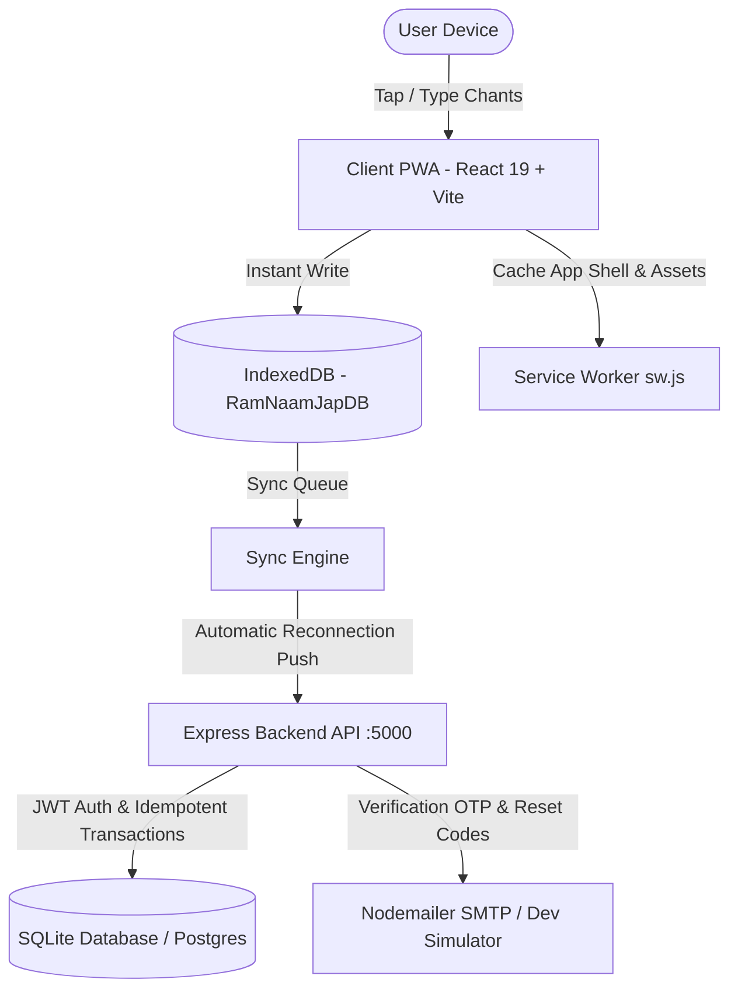

# Shri Ram Naam Jap Counter (श्री राम नाम जप)

> **"Ram Naam Jap Counter — an installable PWA with offline chanting, automatic synchronization, jap history, monthly and yearly analytics, and a 1 Crore Ram Naam goal tracker."**

[](https://github.com/devraj0052/ram-naam-jap-counter)
[](LICENSE)
[](https://nodejs.org)
[](https://vitejs.dev)
[](https://react.dev)
[](https://tailwindcss.com)
[](https://web.dev/progressive-web-apps/)

**Official Repository:** [https://github.com/devraj0052/ram-naam-jap-counter.git](https://github.com/devraj0052/ram-naam-jap-counter.git)

---

## 📖 Table of Contents
1. [Project Overview](#1-project-overview)
2. [Project Purpose & Key Features](#2-project-purpose--key-features)
3. [Visual Assets & UI Highlights](#3-visual-assets--ui-highlights)
4. [Technology Stack & Architecture](#4-technology-stack--architecture)
5. [Complete Project Folder Structure](#5-complete-project-folder-structure)
6. [Prerequisites & Software Versions](#6-prerequisites--software-versions)
7. [Installation Instructions](#7-installation-instructions)
8. [Frontend Environment Configuration](#8-frontend-environment-configuration)
9. [Backend Environment Configuration](#9-backend-environment-configuration)
10. [Database Setup & Schema](#10-database-setup--schema)
11. [How to Run Frontend & Backend Locally](#11-how-to-run-frontend--backend-locally)
12. [Development & Production Build Commands](#12-development--production-build-commands)
13. [Automated Testing & Test Results](#13-automated-testing--test-results)
14. [Backend API Endpoints Reference](#14-backend-api-endpoints-reference)
15. [PWA Installation on Android & iOS](#15-pwa-installation-on-android--ios)
16. [Offline Usage & Automatic Synchronization](#16-offline-usage--automatic-synchronization)
17. [History Timeline, Analytics & 1 Crore Goal Tracker](#17-history-timeline-analytics--1-crore-goal-tracker)
18. [Troubleshooting Common Issues](#18-troubleshooting-common-issues)
19. [Security Precautions & Secret Management](#19-security-precautions--secret-management)
20. [Production Deployment Guide](#20-production-deployment-guide)
21. [License Information](#21-license-information)

---

## 1. Project Overview
**Shri Ram Naam Jap Counter** is an installable Progressive Web Application (PWA) and full-stack cross-device platform dedicated to sacred Ram Naam japa (chanting). Engineered with an offline-first architecture, it ensures seamless and instant counting even without internet connectivity. When network connectivity is restored, counts recorded offline are automatically and idempotently synced to the central cloud database without duplicates.

The platform provides a devotional experience with dual chanting modes (Touch Tap and Likhit/Written typing), a 108-bead Mala counter, granular timestamped audit history, interactive monthly and yearly SVG analytics, and a goal tracker for the **1 Crore (10,000,000) Ram Naam Mahayajna**.

---

## 2. Project Purpose & Key Features

### Core Spiritual & Technical Highlights:
- **Completely Silent Tap Counting**: Designed for quiet personal contemplation or temple use; tap feedback is completely silent with no bead click audio or tap vibration, while preserving the sacred resonant temple bell chime on completing a 108-bead Mala.
- **Dual Jap Modes**:
  - *Tap Jap Mode*: Large touch-manipulation circular chant button with sacred aura and selectable Shri Ram Darshan backdrop.
  - *Likhit Jap Mode*: Sacred typing mode where typing `"Ram"`, `"राम"`, or `"રામ"` automatically increments counts and streams devotional sacred names across the screen.
- **Offline-First Persistence (IndexedDB)**: Stores chanting events immediately in `RamNaamJapDB` with stores for `sync_queue`, `history_events`, `daily_stats`, and `app_state`.
- **Automatic Cloud Synchronization**: Event-driven background synchronization triggered on network reconnection (`online`), app re-opening (`visibilitychange`), Service Worker Background Sync events, or manual user requests.
- **Idempotent Queue Resolution**: Every count increment is assigned a unique `clientEventId` to prevent duplicate counts during retries, slow networks, or concurrent device counting.
- **1 Crore Ram Naam Mahayajna Goal Tracker**: Tracks lifetime progress toward the sacred 10,000,000 target with 4-decimal precision and milestone badges (1 Lakh, 10 Lakh, 25 Lakh, 50 Lakh, 1 Crore).
- **Interactive Monthly & Yearly Charts**: SVG bar charts with leap-year awareness, mobile touch tooltips, and analytics cards (Month Total, Daily Average, Peak Day, Active Consistency).
- **Secure Email Authentication & OTP**: Registration, email verification with 6-digit OTP codes, login, forgot password, and password reset flows with rate limiting.
- **Full Data Portability**: Export your complete chanting records to JSON or legacy `.txt` backup formats; restore from backup at any time.

---

## 3. Visual Assets & UI Highlights

The application contains visual assets located in `client/public/`:
- **PWA App Icons**:
  - `client/public/icon-192.png` (192x192 PNG for Android Home Screen & launcher)
  - `client/public/icon-512.png` (512x512 PNG for high-resolution splash screens)
  - `client/public/favicon.ico` (Browser tab icon)
- **Divine Wallpapers**:
  - `client/public/assets/ram/darshan_1.png` through `darshan_9.png` (9 selectable Shri Ram Darshan wallpapers accessible via the Darshan page)
- **Theme Palette**:
  - Saffron Devotion (`#ff9933`, `#ea580c`, `#d97706`)
  - Midnight Dark (`#0c0a09`, `#1c1917`)
  - Ivory Light (`#fafaf9`, `#ffffff`)

---

## 4. Technology Stack & Architecture

### System Architecture Diagram


### Technology Breakdown
- **Frontend**: React 19, TypeScript, Vite 6, Tailwind CSS, Lucide React icons, Canvas Confetti.
- **Client Offline Storage**: HTML5 IndexedDB (`RamNaamJapDB` v2) with fallback to LocalStorage.
- **PWA**: Service Worker (`sw.js`) with Cache-First app shell caching, stale-while-revalidate CORS asset caching, and Background Sync API registration.
- **Backend**: Node.js, Express, TypeScript (`tsx`), CORS, Rate-Limiting (`express-rate-limit`).
- **Database**: Node.js native `DatabaseSync` SQLite in Write-Ahead Logging (WAL) mode (`ramjap.sqlite`) with production PostgreSQL migration support (`backend/migrations/001_init_postgres.sql`).
- **Authentication**: JWT tokens, bcrypt password hashing, cryptographically secure 6-digit OTP generation.
- **Email Service**: Nodemailer SMTP supporting Gmail App Passwords, Resend, Brevo, or built-in Development Simulation mode.
- **Mobile Native**: React Native with Expo 51 (`mobile/App.tsx`).

---

## 5. Complete Project Folder Structure

```text
ram-naam-jap-counter/
├── .gitignore                          # Excludes node_modules, build outputs, .env, and database files
├── LICENSE                             # MIT License
├── package.json                        # Monorepo root package.json with unified scripts
├── README.md                           # Master project documentation and run instructions
├── shared/
│   └── types.ts                        # Shared TypeScript interfaces (User, CountEvent, SyncPayload)
│
├── backend/                            # Express + TypeScript + SQLite backend service
│   ├── .env.example                    # Template environment configuration
│   ├── package.json                    # Backend dependencies and test scripts
│   ├── tsconfig.json                   # TypeScript compiler configuration
│   ├── migrations/
│   │   └── 001_init_postgres.sql       # PostgreSQL production database schema
│   ├── test/
│   │   ├── e2e.test.ts                 # 14 End-to-End integration test scenarios
│   │   └── offline_sync_test.ts        # 6 Offline queue and idempotency test scenarios
│   └── src/
│       ├── server.ts                   # Express server entry point, CORS, routes
│       ├── config/
│       │   ├── db.ts                   # SQLite DatabaseSync initialization, migrations, & WAL mode
│       │   └── env.ts                  # Type-safe environment variable parser
│       ├── controllers/
│       │   ├── authController.ts       # Register, login, OTP verification, password reset, account deletion
│       │   └── syncController.ts       # Idempotent push, pull, stats, history, export, import
│       ├── middleware/
│       │   ├── authMiddleware.ts       # JWT Bearer authentication validator
│       │   └── rateLimiter.ts          # Auth, OTP, and password reset rate limiters
│       ├── routes/
│       │   ├── authRoutes.ts           # /api/auth routes
│       │   └── syncRoutes.ts           # /api/sync routes
│       ├── services/
│       │   └── emailService.ts         # Nodemailer SMTP dispatcher with dev fallback
│       ├── types/
│       │   └── shared.ts               # Shared domain interfaces
│       └── utils/
│           └── token.ts                # JWT generation, token verification, OTP generator
│
├── client/                             # Vite + React 19 + Tailwind CSS PWA Frontend
│   ├── .env.example                    # Frontend environment template
│   ├── index.html                      # HTML5 entry with PWA manifest and viewport settings
│   ├── package.json                    # Frontend dependencies and build scripts
│   ├── postcss.config.js               # PostCSS configuration for Tailwind CSS
│   ├── tailwind.config.js              # Custom saffron devotional color themes
│   ├── tsconfig.json                   # React TypeScript configuration
│   ├── vite.config.ts                  # Vite build configuration and backend proxying
│   ├── public/
│   │   ├── favicon.ico                 # Browser tab favicon
│   │   ├── icon-192.png                # 192px PWA home screen icon
│   │   ├── icon-512.png                # 512px PWA splash screen icon
│   │   ├── manifest.webmanifest        # W3C Web App Manifest (standalone display)
│   │   ├── sw.js                       # Service Worker with background sync and caching
│   │   └── assets/ram/                 # 9 Shri Ram Darshan divine wallpapers
│   └── src/
│       ├── main.tsx                    # React DOM root render
│       ├── App.tsx                     # Top-level application router and providers
│       ├── index.css                   # Global stylesheet and glowing animations
│       ├── components/
│       │   ├── CroreGoalProgress.tsx   # 1 Crore Mahayajna progress tracker & milestones
│       │   ├── FooterNav.tsx           # Mobile bottom navigation bar
│       │   ├── GuestMigrationModal.tsx # Guest offline count merge prompt upon login
│       │   ├── JapHistoryTimeline.tsx  # Grouped history timeline with date/count filters
│       │   ├── MalaCounter.tsx         # Tap and Likhit counters with 75ms debounce
│       │   ├── MonthlyJapChart.tsx     # Interactive SVG monthly/yearly bar charts
│       │   ├── Navbar.tsx              # Desktop top navbar with Home, History, Darshan, SyncBadge
│       │   ├── PwaInstallPrompt.tsx    # Installation banner for Android, Chrome, and iOS
│       │   ├── SyncBadge.tsx           # Real-time sync state pill with retry trigger
│       │   └── TargetProgress.tsx      # Daily target progress bar and streak tracker
│       ├── context/
│       │   ├── AuthContext.tsx         # User authentication, token, and session lifecycle
│       │   ├── JapContext.tsx          # Real-time chanting counts and audio controls
│       │   ├── LanguageContext.tsx     # English, Gujarati, and Hindi localization
│       │   └── ThemeContext.tsx        # Saffron, Dark, and Light theme provider
│       ├── i18n/
│       │   └── translations.ts         # Multilingual dictionaries
│       ├── pages/
│       │   ├── DarshanPage.tsx         # Wallpaper gallery and devotional chaupais
│       │   ├── ForgotPasswordPage.tsx  # Forgot password OTP request
│       │   ├── HistoryPage.tsx         # Daily audit logs, charts, and cross-device sessions
│       │   ├── HomePage.tsx            # Main counter and daily target
│       │   ├── LoginPage.tsx           # Email and password login
│       │   ├── ProfilePage.tsx         # User profile, backup/restore, delete account
│       │   ├── RegisterPage.tsx        # Registration with password confirmation
│       │   ├── ResetPasswordPage.tsx   # Password reset with 6-digit OTP
│       │   └── VerifyEmailPage.tsx     # 6-digit OTP email verification
│       └── services/
│           ├── api.ts                  # REST API client with Bearer token authentication
│           ├── audioService.ts         # Silent tap synthesizer and 108 Mala bell chime
│           ├── indexedDbService.ts     # Client IndexedDB persistence (RamNaamJapDB)
│           └── syncEngine.ts           # Idempotent offline queue, debounce flush, auto-retry
│
└── mobile/                             # React Native + Expo mobile application
    ├── App.tsx                         # Native mobile application
    ├── app.json                        # Expo configuration
    ├── eas.json                        # EAS build profile for Android APK
    └── package.json                    # Expo dependencies
```

---

## 6. Prerequisites & Software Versions

Before running the application, ensure the following software is installed on your computer:
- **Operating System**: Windows 10/11, macOS, or Linux
- **Node.js**: `v20.0.0` or higher (verified on Node `v24.x` / `v20.x`)
- **npm**: `v10.0.0` or higher
- **Git**: `v2.40.0` or higher
- **Browser**: Google Chrome, Microsoft Edge, Brave, or Safari with IndexedDB and Service Worker support

Verify your environment by running:
```powershell
node -v
npm -v
git --version
```

---

## 7. Installation Instructions

Follow these step-by-step instructions to set up the repository:

### Step 1: Clone the Repository
```powershell
git clone https://github.com/devraj0052/ram-naam-jap-counter.git
cd ram-naam-jap-counter
```

### Step 2: Install Dependencies
Install dependencies for both the backend and frontend:
```powershell
# 1. Install root dependencies
npm install

# 2. Install backend dependencies
cd backend
npm install

# 3. Install frontend dependencies
cd ../client
npm install

# 4. Return to root
cd ..
```

---

## 8. Frontend Environment Configuration

In the `client/` folder, create `.env` from the provided `.env.example`:

```powershell
cd client
cp .env.example .env
```

Contents of `client/.env`:
```env
# Backend API Base URL
VITE_API_URL=http://localhost:5000/api
```

---

## 9. Backend Environment Configuration

In the `backend/` folder, create `.env` from the provided `.env.example`:

```powershell
cd backend
cp .env.example .env
```

Contents of `backend/.env`:
```env
# Server Configuration
PORT=5000
NODE_ENV=development

# JWT Secret for Session & Tokens
JWT_SECRET=dev_shri_ram_jap_secure_jwt_secret_key_2026
JWT_EXPIRES_IN=7d

# Frontend Application URL (for CORS and reset links)
CLIENT_URL=http://localhost:5173

# SQLite Database File Path
DB_PATH=ramjap.sqlite

# Optional: Real SMTP Configuration for Live Gmail Delivery
# If left blank, OTP codes are logged directly to the server console and shown in the UI
SMTP_SERVICE=
SMTP_HOST=
SMTP_PORT=587
SMTP_USER=
SMTP_PASS=
SMTP_FROM=Shri Ram Naam Jap <noreply@ramjap.org>
```

> **Note for Gmail Users**: To send live emails to real inboxes, enable 2-Step Verification on your Google Account, generate a 16-character [Google App Password](https://myaccount.google.com/apppasswords), and enter it as `SMTP_PASS` with your Gmail address in `SMTP_USER`.

---

## 10. Database Setup & Schema

The backend uses SQLite via Node.js native `DatabaseSync` in Write-Ahead Logging (`WAL`) mode.
- **Zero Configuration**: No manual database server setup or Docker container is required for local development.
- **Automatic Migration**: When the backend starts, it automatically creates `ramjap.sqlite` and executes internal table schemas with foreign keys and indexes:
  - `users`: User profiles, hashed passwords, verification state, daily targets.
  - `count_events`: Idempotent chant events indexed on `(user_id, client_event_id)` and `(user_id, timestamp DESC)`.
  - `daily_stats`: Aggregated daily counts and malas per user and date.
  - `sync_sessions`: Device tracking for cross-device sessions.
  - `verification_tokens`: Time-limited OTP codes with rate limiting.

### Optional Production PostgreSQL Migration
For high-scale cloud deployments (e.g., Supabase, Neon, AWS RDS), execute the included migration:
```bash
psql -h <host> -U <user> -d ramjap -f backend/migrations/001_init_postgres.sql
```

---

## 11. How to Run Frontend & Backend Locally

### Option A: Running with Two Terminals (Recommended)

**Terminal 1 — Backend API Server:**
```powershell
cd c:\Users\Devraj\Documents\antigravity\Counter\backend
npm start
```
*Output confirmation:*
```text
[Database] SQLite connected at ramjap.sqlite
====================================================
  Shri Ram Naam Jap Backend API v2.0
  Server running on http://localhost:5000
  Environment: development
====================================================
```
*Verify health check by visiting:* `http://localhost:5000/api/health`

**Terminal 2 — Frontend Client:**
```powershell
cd c:\Users\Devraj\Documents\antigravity\Counter\client
npm run dev
```
*Output confirmation:*
```text
  VITE v6.4.4  ready in 250 ms

  ➜  Local:   http://localhost:5173/
  ➜  Network: use --host to expose
```
Open `http://localhost:5173` in your browser.

---

## 12. Development & Production Build Commands

### Client Production Build
To create an optimized production bundle:
```powershell
cd client
npm run build
```
This runs TypeScript checking (`tsc -b`) and Vite production bundling, generating static assets in `client/dist/`.

To preview the production build locally:
```powershell
npm run preview
```

### Backend Build / Type Check
```powershell
cd backend
npx tsc --noEmit
```

---

## 13. Automated Testing & Test Results

The project includes two automated test suites:
1. `backend/test/e2e.test.ts`: Complete authentication, sync, security, and export tests.
2. `backend/test/offline_sync_test.ts`: Offline queue, batching, and idempotency tests.

Run all tests with:
```powershell
cd backend
npm test
```

### Actual Test Suite Results:
```text
======================================================
🔱 STARTING SHRI RAM NAAM JAP E2E TEST SUITE 🔱
======================================================
✅ [PASS] 1. Register using a new email address
✅ [PASS] 2. Reject invalid registration inputs (short password, mismatched pass)
✅ [PASS] 3. Verify email with time-limited 6-digit code
✅ [PASS] 4. Log in with verified email and retrieve user profile
✅ [PASS] 5. Reject invalid credentials during login
✅ [PASS] 6. Forgot and reset password with 6-digit OTP code
✅ [PASS] 7. Count repetitions and confirm persistent storage in SQLite
✅ [PASS] 8. Log in on another device and confirm cross-device synchronization
✅ [PASS] 9. Retry scenario: sending duplicate event IDs must NOT double count
✅ [PASS] 10. Multi-user security: Confirm User B cannot access User A data
✅ [PASS] 11. Personal data export & legacy backup format import
✅ [PASS] 12. Query paginated and filtered Jap history via /sync/history
✅ [PASS] 13. User logout via /auth/logout
✅ [PASS] 14. Account deletion with password confirmation

======================================================
📱 TESTING OFFLINE COUNTING & RECONNECTION SYNC 📱
======================================================
✅ Scenario 1: Initial user session verified
✅ Scenario 2: Generated 5 offline events (+540 Ram Naam) queued locally
✅ Scenario 3: All 5 offline events pushed to server. Confirmed total: 540
✅ Scenario 4: Idempotency verified - Re-sent events did not duplicate
✅ Scenario 5: History timeline verified with date and exact timestamps
✅ Scenario 6: Pull endpoint returns authoritative state and recentEvents

✔ 14/14 E2E Tests Passed
✔ 6/6 Offline Sync Scenarios Passed
Total: 20/20 Passed (100%)
```

---

## 14. Backend API Endpoints Reference

### Authentication Endpoints (`/api/auth`)
| Method | Endpoint | Description | Protected |
| :--- | :--- | :--- | :---: |
| `POST` | `/api/auth/register` | Register new user with full name, email, password | No |
| `POST` | `/api/auth/verify-email` | Verify email with 6-digit OTP code | No |
| `POST` | `/api/auth/resend-verification` | Resend 6-digit verification OTP (rate limited) | No |
| `POST` | `/api/auth/login` | Authenticate with email and password | No |
| `POST` | `/api/auth/forgot-password` | Request password reset OTP | No |
| `POST` | `/api/auth/reset-password` | Set new password with verified OTP | No |
| `GET` | `/api/auth/me` | Fetch authenticated user profile & preferences | **Yes** |
| `POST` | `/api/auth/logout` | Invalidate current session | **Yes** |
| `POST` | `/api/auth/change-password` | Change password with current password confirmation | **Yes** |
| `PUT` | `/api/auth/preferences` | Update language, theme, daily mala target | **Yes** |
| `DELETE`| `/api/auth/account` | Permanently erase user account and all data | **Yes** |
| `GET` | `/api/auth/smtp-status` | Diagnostic inspection of SMTP configuration | No |
| `POST` | `/api/auth/test-smtp` | Dispatch test email to verify delivery | **Yes** |

### Synchronization Endpoints (`/api/sync`)
| Method | Endpoint | Description | Protected |
| :--- | :--- | :--- | :---: |
| `POST` | `/api/sync/push` | Push idempotent batch of count events from client | **Yes** |
| `GET` | `/api/sync/pull` | Pull authoritative totals, daily stats, and recent events | **Yes** |
| `GET` | `/api/sync/stats` | Retrieve daily and lifetime statistics | **Yes** |
| `GET` | `/api/sync/history` | Paginated and filtered chant audit history | **Yes** |
| `GET` | `/api/sync/export` | Export full backup in JSON and legacy formats | **Yes** |
| `POST` | `/api/sync/import` | Restore counts from JSON or legacy text backup | **Yes** |

---

## 15. PWA Installation on Android & iOS

### On Android (Chrome / Edge / Brave):
1. Navigate to the website URL in Google Chrome.
2. An **"Install Mobile App"** prompt banner will appear at the top. Tap **"Install PWA to Home Screen"**.
3. Alternatively, tap the Chrome menu (**⋮**) in the top right and select **"Add to Home screen"** or **"Install app"**.
4. The Ram Naam Jap Counter icon appears on your home screen and launches in full-screen standalone mode without browser URL bars.

### On iOS (iPhone / iPad):
1. Open the website in **Safari**.
2. Tap the **Share** button (`⎙` / square with arrow) at the bottom.
3. Scroll down and tap **"Add to Home Screen"**.
4. Tap **Add** in the top right.

---

## 16. Offline Usage & Automatic Synchronization

1. **Local Counting**: When offline (e.g. Airplane Mode), each tap increments the local count immediately with zero UI lag.
2. **IndexedDB Queue**: Every increment is persisted to IndexedDB (`RamNaamJapDB` -> `sync_queue`).
3. **Status Indicator**: The sync badge in the top bar indicates `Offline` or `Pending Sync (N)`.
4. **Automatic Reconnection Flush**:
   - The sync engine listens to browser `online` events, `visibilitychange` events, and Service Worker Background Sync events.
   - Upon reconnection, pending events are automatically flushed in a batch to `/api/sync/push`.
   - The server acknowledges processed `clientEventId` records, and the client removes them from the pending queue.
   - The badge transitions smoothly to `Syncing...` and then `Synced`.

---

## 17. History Timeline, Analytics & 1 Crore Goal Tracker

### 1 Crore Ram Naam Mahayajna Goal Tracker
- Exact target: **1,00,00,000** (10 Million) Ram Naam chants.
- Progress bar displaying completed counts, remaining counts, and progress percentage to 4 decimal places.
- Checkpoint milestones: 1 Lakh, 10 Lakh, 25 Lakh, 50 Lakh, and 1 Crore.

### Interactive Monthly & Yearly Charts
- **Monthly View**: Daily bar chart for the selected month, accounting for leap years. Touch or hover any bar to view the exact count and completed malas.
- **Yearly View**: 12-month overview showing chanting intensity throughout the year with year navigators.
- **Analytics Metrics**: Month Total, Daily Average per active day, Peak Chanting Day, and Consistency percentage.

### Granular History Audit Log
- Groups all chanting sessions into **Today**, **Yesterday**, **This Week**, and specific calendar dates.
- Each entry displays the exact local time (`HH:MM:SS AM/PM`), count increment (`+108 Ram`), and cloud verification badge (`Synced`).
- Search bar allows instant filtering by date (`YYYY-MM-DD`) or count, with a 1-tap `<X>` clear button.

---

## 18. Troubleshooting Common Issues

### 1. Port 5000 or 5173 Already in Use
If the port is occupied, kill the existing process or modify the port:
```powershell
# Find process using port 5000 on Windows:
Get-Process -Id (Get-NetTCPConnection -LocalPort 5000).OwningProcess | Stop-Process -Force
```

### 2. OTP Not Received in Email
- If `SMTP_USER` and `SMTP_PASS` are blank in `backend/.env`, the system runs in **Development Mode**: the OTP code is printed directly to the backend terminal log and displayed on the verification screen for easy testing.
- For real emails, ensure you are using a **Google App Password** (16 characters), not your regular Google account password.

### 3. PWA Not Showing Offline Changes
- Clear outdated service workers by opening DevTools -> Application -> Service Workers -> **Update on reload** or click **Unregister**.
- The service worker includes a `SKIP_WAITING` listener to update caches smoothly.

---

## 19. Security Precautions & Secret Management

- **Never Commit Secrets**: `.env` files are strictly excluded via `.gitignore`. Always use `.env.example` templates for configuration sharing.
- **Password Security**: Passwords are never stored in plaintext; they are hashed using bcrypt with 10 salt rounds.
- **Data Isolation**: All sync and history queries enforce strict `user_id = ?` scoping; users can never view or modify another user's records.
- **Rate Limiting**: Public authentication routes (`/register`, `/login`, `/forgot-password`, `/resend-verification`) are protected against brute force attacks.

---

## 20. Production Deployment Guide

### A. Backend Deployment to Render (Step-by-Step)

The backend is configured for deployment on [Render](https://render.com) as a Node.js Web Service or via the included `render.yaml` Blueprint.

#### Method 1: Render Dashboard Manual Setup (Recommended)
1. **Create Web Service**:
   - Go to [dashboard.render.com](https://dashboard.render.com) and click **New +** -> **Web Service**.
   - Connect your GitHub repository: `https://github.com/devraj0052/ram-naam-jap-counter`.
2. **Configure Service Settings**:
   - **Name**: `shri-ram-jap-backend` (or any custom name)
   - **Region**: Choose the region closest to you (e.g., Singapore, Frankfurt, Oregon, Ohio).
   - **Root Directory**: `backend` *(CRITICAL: must specify `backend`)*
   - **Environment**: `Node`
   - **Build Command**: `npm install && npm run build`
   - **Start Command**: `npm start` *(runs `node dist/server.js`)*
   - **Plan**: `Free` (or `Starter` if using a Persistent Disk)
3. **Environment Variables**:
   Under **Environment Variables**, add:
   | Key | Value | Description |
   | :--- | :--- | :--- |
   | `NODE_VERSION` | `22` | Requires Node.js >= 22 for native SQLite (`node:sqlite`) |
   | `NODE_ENV` | `production` | Enables production mode & error masking |
   | `PORT` | `10000` | Render default port (injected dynamically) |
   | `JWT_SECRET` | `openssl rand -base64 32` | Generate a strong 32+ character random secret |
   | `FRONTEND_URL` | `https://your-app.vercel.app` | Your deployed Vercel frontend URL (no trailing slash) |
   | `CLIENT_URL` | `https://your-app.vercel.app` | Fallback URL for email verification links |
   | `DB_PATH` | `ramjap.sqlite` | SQLite database file location (or persistent disk mount) |
4. **Health Check Path**:
   - Set **Health Check Path** to: `/api/health`
5. **Database Persistence on Render**:
   - **Free Tier (Ephemeral)**: Uses `DB_PATH=ramjap.sqlite`. Note that Render Free tier spins down on idle and disk resets on redeploys.
   - **Persistent Disk (Production Safe)**: On a paid Render plan, add a Disk (e.g. 1 GB) mounted at `/var/data` and set `DB_PATH=/var/data/ramjap.sqlite`. SQLite will permanently persist all user accounts and counts across server restarts.
   - **External PostgreSQL**: Alternatively, you can provision a Render PostgreSQL instance using the migration script at `backend/migrations/001_init_postgres.sql`.

---

### B. Frontend Deployment to Vercel (Step-by-Step)
1. In [Vercel Dashboard](https://vercel.com), click **Add New...** -> **Project** and select this GitHub repository.
2. Configure project:
   - **Framework Preset**: `Vite`
   - **Root Directory**: `client` *(CRITICAL: select `client` directory)*
   - **Build Command**: `npm run build`
   - **Output Directory**: `dist`
3. Add Environment Variable:
   - `VITE_API_URL` = `https://<your-render-backend>.onrender.com/api`
4. Deploy! The included `client/vercel.json` automatically handles client-side SPA routing (`/verify-email`, `/reset-password`, etc.).

---

## 21. License Information

This project is licensed under the **MIT License**. See the [LICENSE](LICENSE) file for complete terms and copyright notices.

```text
Copyright (c) 2026 Devraj (devraj0052)
```

---

May Lord Shri Ram bless your spiritual journey!  
**॥ जय श्री राम ॥**
